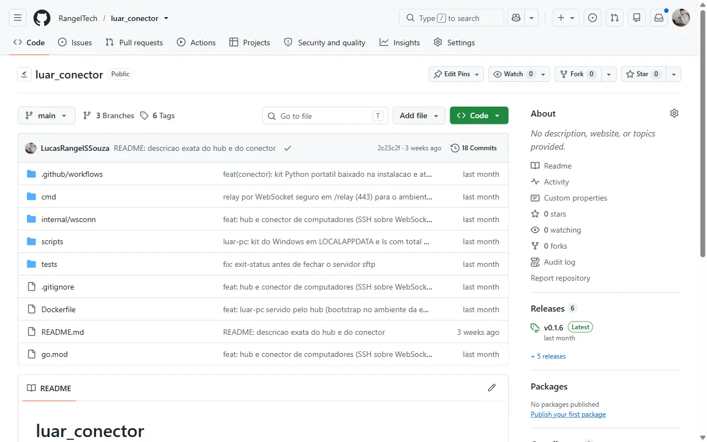

<!-- readme-padrao -->
# LUAR: hub de conectores

> Hub de conectores do LUAR (integrações externas dos clientes).

## O que é
Hub de conectores do LUAR (integrações externas dos clientes).

Estado: **no ar (LUAR em preparo)**.

## Onde está no ar
- Sem endereço público próprio.

## Onde faz o deploy
Este repositório **só publica** o artefato (release com imagem e manifesto); **quem implanta é o `vps_rt_infra`**.

- Serviço `luar-conector-hub`: `gh workflow run deploy.yml --repo RangelTech/vps_rt_infra -f service=luar-conector-hub` (só validar: `-f dry_run=true`; voltar versão: `-f version=<tag-antiga>`)

Os `.env` desses serviços são gerados do Infisical no momento do deploy (spec 57, seção 0A).

## Como funciona por dentro
Resumo acima; os detalhes estão nas notas técnicas (README anterior) abaixo e na spec 57.

## Segredos
Nenhum valor de segredo fica neste repositório. Os segredos dos serviços ficam no Infisical (mapa em `vps_rt_infra/scripts/infisical/mapa_envs.json`) e chegam à VPS gerados no deploy.

## Rodar e testar localmente
Ver as notas técnicas abaixo (cada repositório tem o seu jeito); os testes de QA em produção são por cliques reais, com evidência em `new_ragente/qa/evidencias`.

## Links
- Repositório: https://github.com/RangelTech/luar_conector
- Painel único: https://painel.rangeltech.net
- Spec de organização geral: `new_ragente/specs/57_ORGANIZACAO_GERAL_PRODUTOS_E_PAINEL.md`

## Notas técnicas (README anterior)

# luar_conector

Hub e conector de computadores do LUAR (Spec 11 §26), em Go 1.22. O computador do cliente abre uma conexão de saída até o hub (sem abrir porta); o hub mantém a presença (online ou offline) e repassa os bytes entre o ssh do ambiente da empresa e o servidor SSH embutido no computador. O hub não conhece segredos de SSH: só encaminha.

- `cmd/hub`: servidor que recebe as conexões (implantado como o serviço `luar-conector-hub` pelo `vps_rt_infra`; endereço `conector.rangeltech.net`).
- `cmd/connector`: programa `luar-conector` do computador do cliente. Comandos: `pair --hub <url> --code <código>` (parear), `install` (instalar como serviço), `run`, `uninstall`, `status`, `version`.
- `internal/wsconn`: camada de WebSocket usada pelos dois.
- `scripts/`: `build_kits.sh` (kits por sistema), `install.sh`, `luar-pc` e `luar-relay.py` (relay de linha de comando), `mklatest.py`.
- `tests/e2e.sh`: teste de ponta a ponta.

Versão: tag `v*` publica a imagem e o manifesto; o deploy é só pelo `vps_rt_infra` (`deploy.yml -f service=luar-conector-hub`). Specs: `luar_docs/specs/11`.

Mapa geral do ecossistema: skill `ecossistema_rt` (repositório `personal-skills`).
